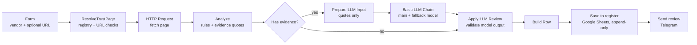

# Vendor Security Soft-Check with n8n

An n8n workflow for a preliminary security review of a SaaS or AI vendor based on its public trust / security page. It checks the page against an 8-domain soft-check checklist, attaches an evidence quote to every finding, uses an LLM as a second-opinion layer, writes the result to an append-only review register in Google Sheets and sends a report to Telegram.

The output is a **preliminary recommendation**, not an audit. The final decision is always made by a person.


---

## Problem

Before a new SaaS or AI tool is approved for use, security has to answer the same questions every time: does the vendor have SOC 2 / ISO 27001, is data encrypted, can MFA and SSO be enforced, is there a DPA, does the vendor train AI models on customer data. Collecting this by hand from trust pages is repetitive. This workflow does the first pass automatically and shows the evidence it relied on.

## Architecture



## How it works

| Node | What it does |
|------|--------------|
| **Form** | Vendor name and, optionally, the URL of its security page. |
| **ResolveTrustPage** | Takes the URL from the form or from a small registry of known vendors. Validates it before any request: https only, port 443, public domain names only. IP addresses, `localhost`, internal zones and `user@host` URLs are rejected, so the form cannot be used to make the server call internal resources. |
| **HTTP Request** | Downloads the page. Does not fail on HTTP errors; the status code is passed on. |
| **Analyze** | Converts HTML to text and searches for 32 signals in 7 domains. Every found signal gets a short quote from the page. Sets the page status and the preliminary recommendation. |
| **Has evidence?** | If no quotes were found, the LLM is skipped entirely (no tokens spent on an empty request). |
| **Prepare LLM Input** | Sends the model only the short quotes, never the whole page. Cleans the quotes and the vendor name. |
| **Basic LLM Chain** | The model checks whether each quote really supports the control (`confirmed` / `negated` / `unclear`). Main model plus a fallback model from another provider. No tools, no web access. |
| **Apply LLM Review** | Treats the model output as untrusted: parses JSON, ignores unknown values and out-of-range items. Adds flags for the reviewer; does **not** change the recommendation. |
| **Build Row / Save to register** | One row per review, append-only. Values are escaped to prevent formula injection in Google Sheets. |
| **Send review** | Report to Telegram, HTML-escaped. |

## Soft-check domains

1. **Vendor / service:** vulnerability disclosure or bug bounty, security contact
2. **Data & privacy:** data residency, subprocessors, PII, AI training on customer data, DPA, retention
3. **Authentication & access:** MFA (and whether it can be enforced), SSO / SAML, SCIM, RBAC, plan-dependent features
4. **Encryption & keys:** in transit, at rest, end-to-end / zero-knowledge, algorithm, KMS, BYOK
5. **Integrations & permissions:** documented scopes
6. **Security & compliance:** SOC 2, ISO 27001 / 27701 / 42001, GDPR, penetration testing
7. **Fit with corporate controls:** audit logs, SIEM export, DLP, sharing restrictions
8. **Decision:** approve with conditions / escalate / manual review

Each domain also lists **manual checks** that cannot be answered from a public page (vendor reputation, scope proportionality, whether the tool bypasses existing DLP / IAM / SSO). They are shown in the report for the reviewer.

## Page status

| Status | Meaning | Result |
|--------|---------|--------|
| `OK` | Page read, signals searched | report by domain + recommendation |
| `INSUFFICIENT_CONTENT` | Page is rendered by JavaScript (empty HTML shell) | manual review, no "missing control" conclusions |
| `FETCH_ERROR` | Page returned 403, 404 or another error | manual review with the status code |

Not finding a signal is reported as **"not found on this page"**, never as "missing": the vendor may describe it elsewhere.

## Security design

- **Server-side request forgery protection** on every user-supplied URL.
- **Untrusted input everywhere:** the vendor page, the form fields and the model output are all treated as untrusted.
- **Prompt injection mitigation:** the model gets only short quotes inside explicit delimiters, the system prompt states that the content is untrusted data, the response format is fixed JSON and is validated in code, and the model cannot change the decision.
- **Least capability for the AI component:** no tools, no web access, advisory output only.
- **Output encoding:** formula injection protection for Google Sheets, HTML escaping for Telegram.
- **Audit trail:** append-only register, separate columns for the reviewer's final decision.
- **Secrets** only in n8n Credentials; nothing hardcoded in nodes or in the exported JSON.

## Test results

| Vendor | Result | What it shows |
|--------|--------|---------------|
| Grammarly | OK, no critical gaps | SOC 2, ISO 27001 / 27701 / 42001, AES-256, KMS; the LLM flagged that "identity provider integration" does not explicitly mean SCIM |
| Slack | OK, approve with conditions | strong compliance; MFA not described on this page |
| 1Password | OK, few signals | keyword search missed end-to-end encryption, so an E2EE signal was added |
| Claude (Anthropic) | `INSUFFICIENT_CONTENT` | trust center is rendered by JavaScript; LLM skipped |
| `http://169.254.169.254/` | rejected | https only |
| `https://trust.anthropic.com@169.254.169.254/` | rejected | `user@host` trick blocked |

## Limitations

- Only one page per vendor is checked.
- Pages rendered by JavaScript cannot be read by a plain HTTP request.
- Keyword matching finds wording, not meaning; the LLM layer reduces but does not remove this.
- The result reflects public claims only. It is not a substitute for the vendor's SOC 2 report, DPA or a full assessment.

## Roadmap

- [ ] Check each requirement separately and search standard vendor pages (`/security`, `/trust`, `/privacy`, `/legal/dpa`) before giving up
- [ ] AI-assisted search for critical gaps only, restricted to the vendor's domain, with the quote verified in code against the source page
- [ ] Rule-based implementation recommendations: controls to set up before go-live, monitoring, data restrictions, review date
- [ ] Jira integration: start from a vendor review ticket, post the result as a comment

## Lessons learned

- **Missing data is not a negative result.** A JavaScript-rendered page with no text must lead to manual review, not to "no certifications".
- **A model is a second opinion, not a judge.** Rules make the decision; the model only flags quotes that look contradictory or unclear.
- **Skip the model when there is nothing to analyse.** Calling an LLM on an empty list only costs tokens.
- **Separate keys from labels.** Logic works on stable internal identifiers; report language is a separate dictionary, so translating the report cannot break the scoring.

## How to run

1. Import `workflow/vendor-softcheck.json` into n8n.
2. Create credentials: Google Sheets (OAuth2), Telegram API, and an LLM credential (or n8n's built-in AI credits).
3. Create a Google Sheet `Vendor Soft-Check Register` with a `Reviews` sheet and the header row from `docs/register-columns.csv`.
4. Replace `YOUR_CHAT_ID` in the Telegram node.
5. Execute the workflow and submit the form.

## Repository structure

```
.
├── README.md
├── code/
│   ├── resolve_trust_page.js
│   ├── analyze.js
│   ├── prepare_llm_input.js
│   ├── apply_llm_review.js
│   └── build_row.js
├── workflow/
│   └── vendor-softcheck.json
└── docs/
    ├── register-columns.csv
    └── screenshots/
```
